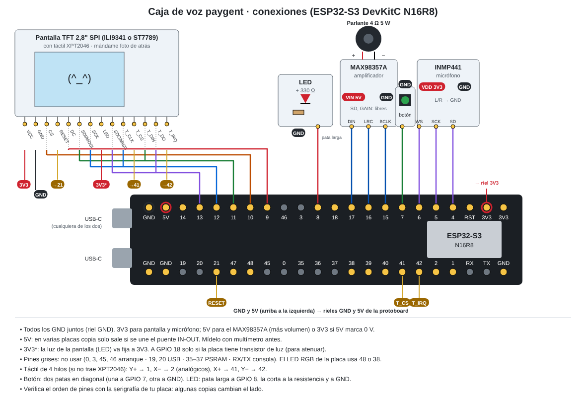
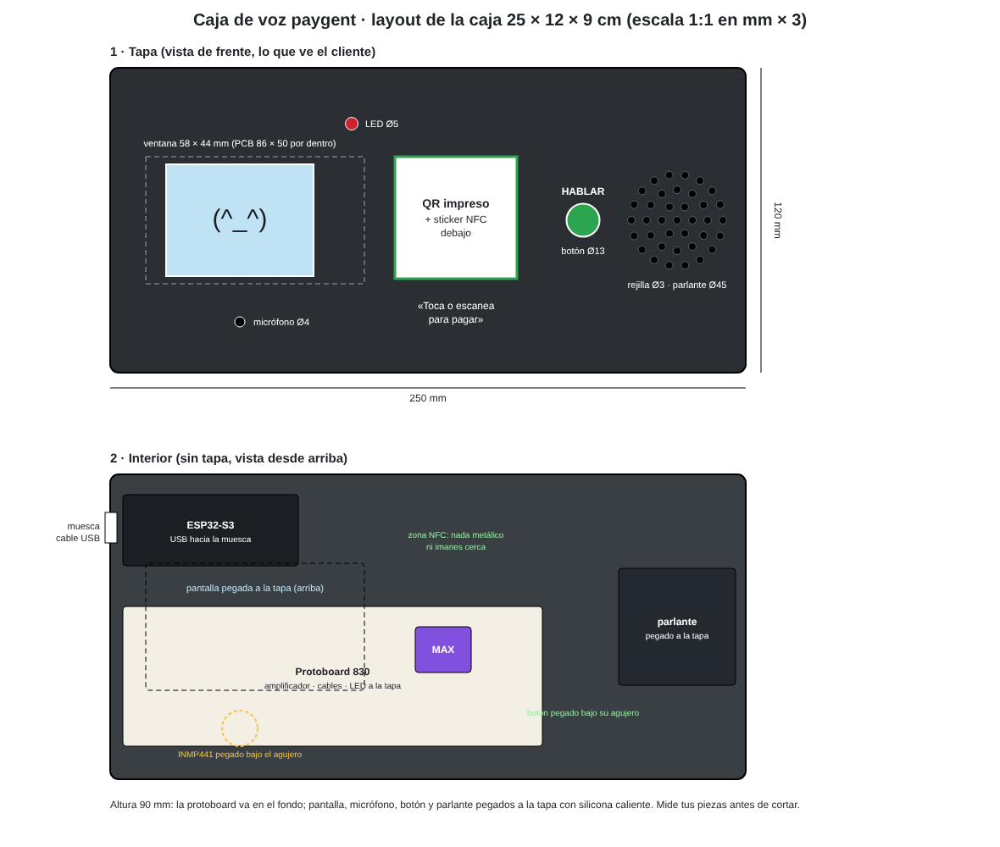
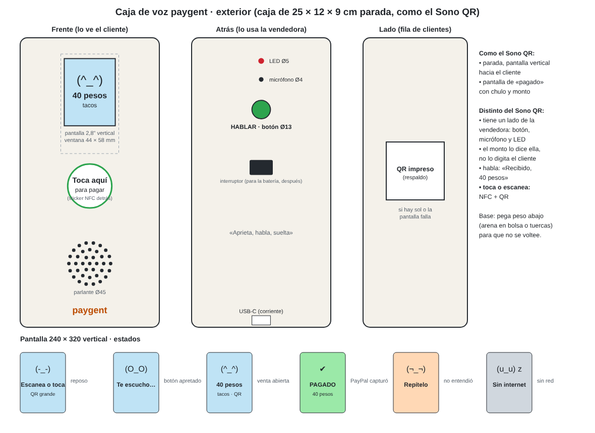
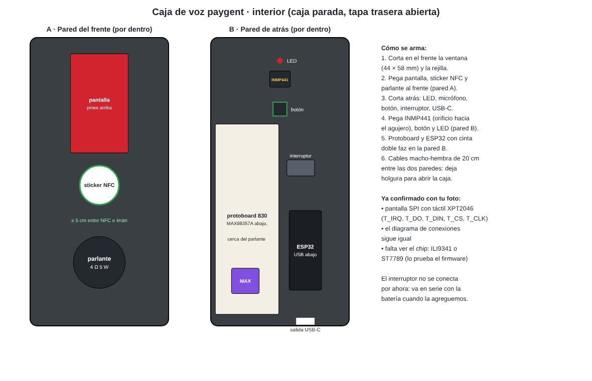

<!-- docs/voice-box-hardware.md: bitácora del hardware de la caja de voz — qué se compró en Bogotá el
     2026-11-09, por qué, cómo se conecta, el firmware que corre (§6) y lo que falta (§6.3). Complementa la spec
     docs/voice-box.md (qué hace la caja) y docs/open-models.md (qué modelos la mueven).
     Precios en COP leídos de las fichas de MercadoLibre ese día; ⏳ = no verificado. -->

# Caja de voz: hardware comprado y plan de armado

> Sesión del 2026-11-09 (Bogotá). La compra llega el martes 2026-11-10. La entrega del hackathon
> cierra el jueves 2026-11-12 a las 15:00 de Bogotá. **Firmware: Arduino propio, funcionando** (§6, 2026-11-12).

## 1. Qué cambió frente a la spec

La spec (`docs/voice-box.md`, §2.1) proponía una M5Stack Atom VoiceS3R o una ESP32-S3-BOX-3. **Ninguna
se consigue en tiendas colombianas**: solo por importadores (Desertcart, Ubuy), que no llegan antes
del cierre. Se armó la caja con piezas sueltas (la opción C de la spec, sin reusar el clip de Lente),
más una pantalla táctil para la cara y el monto.

Otras decisiones del día:

- **Botón para hablar, no palabra de activación.** Se mantiene lo de la spec (§2.2).
- **El QR va impreso, no en pantalla.** El QR de paygent es fijo por terminal (`/t/:terminal`), así
  que la pantalla muestra la cara, el monto y «PAGADO», no el QR. Junto al QR va un sticker NFC
  NTAG215 con la misma URL. El teléfono del cliente lo lee, y la caja no necesita módulo NFC.
- **Una cara en la pantalla**, inspirada en el robot «Jolly» que se vio en LinkedIn. Su pantalla es
  táctil y no se pudo identificar el modelo exacto. Cada estado de la caja tiene su cara (§5).
- **Didácticas Electrónicas no sirvió**: tenía agotados el INMP441 y el MAX98357A, y tarda de 2 a 4
  días hábiles en llegar a Bogotá. Todo se compró en MercadoLibre con entrega para el día siguiente.

## 2. Lo que se compró

### 2.1 MercadoLibre (pedido del 2026-11-09, «llega mañana» en los 5 envíos)

| Envío | Vendedor | Pieza | Cant. | COP |
|---|---|---|---|---|
| 1 (Full) | — | ESP32-S3 DevKitC **N16R8** (16 MB de flash, 8 MB de PSRAM, dos USB-C) | 2 | 80.000 |
| 1 (Full) | — | Cables dupont macho-hembra de 20 cm × 40 | 1 | 11.000 |
| 1 (Full) | — | Stickers NFC NTAG215 × 20 | 1 | 26.990 |
| 2 | Yorobotics | Micrófono INMP441 (I2S) | 1 | 48.195 |
| 3 | Mactrónica | Pantalla TFT táctil de 2,8", 240×320 (ver §2.3) | 1 | 67.000 |
| 4 | Electronilab | Amplificador MAX98357A (I2S, 3 W) | 1 | 29.990 + 9.700 de envío |
| 5 | Electrosena | Pulsadores de 12×12 con capuchón de colores × 3 | 1 | 12.000 |
| 5 | Electrosena | Caja plástica de 25 × 12 × 9 cm (con orejas y muesca para el cable) | 1 | 19.000 |
| 5 | Electrosena | Kit: protoboard de 830 puntos, jumpers macho-macho, LEDs, resistencias | 1 | 28.800 |
| | | **Total pagado** | | **332.675** |

Solo hay 1 micrófono y 1 amplificador: alcanzan para la demo, sin repuesto. La segunda ESP32-S3 es
el repuesto de la placa.

### 2.2 Comprado en un local de Bogotá

- Cautín y estaño. La crema para soldar no se consiguió; no hace falta si el estaño trae flux o
  núcleo de resina.
- Parlante de **4 Ω y 5 W**, con cables y conector. El MAX98357A le entrega como mucho unos 3 W a
  5 V, así que trabaja holgado. El mismo local tiene otro de repuesto.
- Cables dupont macho-macho (en la calle no había macho-hembra; esos vienen en el pedido Full).

### 2.3 La pantalla: dos dudas para resolver al recibirla

El anuncio de Mactrónica se contradice: el título dice **ILI9341** y la descripción dice
**ST7789**, y la descripción parece copiada de otra pantalla (la de Adafruit). Las dos dudas:

1. **El controlador: ILI9341 o ST7789.** Los dos funcionan por SPI con la ESP32-S3; cambia una línea
   de configuración del driver.
2. **El táctil.** La descripción habla de «2 pines digitales y 2 analógicos», que sería un táctil
   resistivo de 4 hilos sin chip. Las pantallas rojas como la de la foto suelen traer un chip
   XPT2046 por SPI (pines T_CLK, T_CS, T_DIN, T_DO, T_IRQ). Los dos sirven, pero cambian los pines.

Se resuelve con una foto de la parte de atrás de la pantalla al recibirla.

### 2.4 Lo que se descartó y por qué

| Pieza | Por qué no |
|---|---|
| M5Stack Atom VoiceS3R, ESP32-S3-BOX-3, M5Stack CoreS3 | No hay existencias en Colombia; solo importadas |
| Waveshare WS-28141 (ESP32-S3 con pantalla de 4,3" y carcasa) | Variante industrial (RS485, CAN), sin audio y casi sin pines libres |
| Waveshare WS-17344 (IPS de 2") | No es táctil |
| «Pantalla Touch TFT Arduino Uno R3» | Por el nombre, es un *shield* de bus paralelo (≈ 13 pines) |
| ESP32-S3 con conector de cámara (CAM) | Otro orden de pines y la cámara no se usa |
| ESP32-S3 Zero | Muy pocos pines, y solo 4 MB de flash y 2 MB de PSRAM |
| Parlantes de 8 Ω y 0,5 W | El MAX98357A a 5 V puede pasarles de lo que aguantan |
| Pulsador redondo de 2 pines | Parece de linterna, de enclavamiento; para hablar hace falta uno momentáneo |
| Llavero NFC de WhatsApp | Puede venir bloqueado; los stickers en blanco son más baratos y se reescriben |
| Kit de 135 piezas (60.000) | Lo que sirve para la caja ya viene en el kit de 28.800 |
| Cautín de 60 W regulable | Se compró en el local, con estaño |

## 3. Cómo se conecta

El primer paso es el diagrama «Conexión Voz a Texto» (ESP32-S3 DevKitC N16R8 + INMP441 + pulsador +
LED). Lo demás se suma después sin mover lo que ya está.

| Pieza | Señal | GPIO | Nota |
|---|---|---|---|
| INMP441 | SD / SCK / WS | 4 / 5 / 6 | L/R a GND (canal izquierdo), VDD a 3V3. Va en I2S0 (recepción) |
| Pulsador | — | 7 | A GND, con `INPUT_PULLUP`. Patas en diagonal |
| LED | — | 8 | Con resistencia de 330 Ω a GND |
| MAX98357A | BCLK / LRC / DIN | 15 / 16 / 17 | Va en I2S1 (transmisión). VIN a 5Vin (más volumen) o 3V3. SD y GAIN sin conectar |
| Pantalla SPI | SCK / MOSI / MISO / CS / DC / RESET | 12 / 11 / 13 / 10 / 9 / 21 | VCC a 3V3. La luz (LED) fija a 3V3; a GPIO 18 solo si el módulo tiene transistor de luz ⏳ |
| Táctil XPT2046 (si lo trae) | T_CLK / T_DIN / T_DO / T_CS / T_IRQ | 12 / 11 / 13 / 41 / 42 | Comparte el bus SPI con la pantalla |
| Táctil de 4 hilos (si es así) | Y+ / X− / X+ / Y− | 1 / 2 / 41 / 42 | Y+ y X− analógicos (ADC1); X+ y Y− digitales |

**Pines que no se usan:** 0, 3, 45 y 46 deciden cómo arranca la placa. 19 y 20 son el USB. En la
N16R8, 35 a 37 son de la PSRAM. 43 y 44 son el puerto serie. El LED RGB de la placa va en el 48 o
el 38, según la versión.

**Detalles de armado:**

- En varias de estas placas, el pin **5Vin** solo da 5 V si se une el puente de soldadura **IN-OUT**.
  Medir con multímetro antes de alimentar el amplificador desde ahí.
- La DevKitC es ancha: en una protoboard de 830 deja una sola fila libre de un lado. Hay que
  montarla entre dos protoboards o conectarla con los cables macho-hembra.
- Los pines del INMP441 y del MAX98357A vienen sin soldar. Sin soldarlos, el contacto falla y el
  micrófono mete ruido.
- El parlante va a la bornera del MAX98357A; para voz, la polaridad no importa.

**La caja (25 × 12 × 9 cm):**

- ventana para la pantalla en la tapa;
- agujero de 3–5 mm para el micrófono, con el INMP441 pegado por dentro (su orificio de sonido mira
  hacia la pared de la caja);
- rejilla de agujeros de 3 mm para el parlante;
- agujero para el pulsador, pegado por dentro con silicona caliente;
- el cable USB sale por la muesca.

El sticker NFC se pega por dentro de la tapa, lejos del imán del parlante, junto al QR impreso y un
texto «Toca o escanea para pagar». Si se forra la caja, el agujero del micrófono queda descubierto.

### 3.1 Versión vertical, como el Sono QR (2026-11-11)

Con las piezas en la mano, la caja se arma **parada**, como el Sono QR de Bold: pantalla vertical
hacia el cliente y base con peso. A diferencia del Sono QR, tiene un lado para la vendedora (botón,
micrófono y LED), y la pantalla muestra la cara, el monto, el QR y «PAGADO». El QR impreso queda en
un costado como respaldo.

La foto de la pantalla confirma que es SPI con táctil XPT2046 (pines T_IRQ, T_DO, T_DIN, T_CS y
T_CLK) y lector de microSD; el diagrama de conexiones no cambia. Falta saber si el chip es ILI9341
o ST7789.

## 4. Plan hasta el cierre

| Día | Qué |
|---|---|
| Mar 10 | Recibir el pedido; foto de la parte de atrás de la pantalla. Soldar los pines del micrófono y del amplificador. Armar el diagrama base. **Decidir el firmware (§6)** y lograr la primera grabación con el botón |
| Mié 11 | Audio de vuelta por el parlante; la cara en la pantalla; probar contra paygent en sandbox |
| Jue 12 | En la mañana, grabar la toma del video en el aparato real. Enviar antes de las 15:00 |

Si algo falla, el respaldo de la demo es el mismo de la spec: la bocina y la cara en el teléfono
(`/soundbox`), y la caja virtual en `/judge`.

## 5. Las caras de la caja

Cara kawaii dibujada con figuras simples: ojos redondos con brillo, cachetes rosados y una boca en
arco. Cada estado reemplaza al LED de la spec (§2.3):

| Estado | Cara | Texto |
|---|---|---|
| En reposo | Ojos cerrados y sonrisa, con parpadeo lento | — |
| Escuchando (botón apretado) | Ojos bien abiertos | «Te escucho…» |
| Pensando | Ojos mirando hacia arriba | Puntos animados |
| Venta abierta | Ojos atentos | «40 pesos · tacos» |
| Pagado | Ojos felices, fondo verde | «PAGADO» |
| No entendió | Cejas confundidas | «Repítelo» |
| Sin internet | Ojos dormidos | «Sin internet» |

«Pagado» solo se muestra cuando el servidor capturó el pago con PayPal: la caja lo sabe por el canal
en vivo de la terminal (`GET /api/terminals/:id/events`), igual que la bocina. La cara no reemplaza
el monto: el monto va en texto grande y dicho en voz alta.

## 6. Firmware: Arduino propio (2026-11-12)

Se eligió **firmware propio en Arduino** (arduino-cli 1.6 + core `esp32:esp32` 3.3.12): era lo más
corto a una toma de video, y la caja habla HTTP directo con paygent. XiaoZhi, ESP-IDF y ESPHome quedaron
descartados por tiempo. Todo vive en `firmware/`:

| Sketch | Qué prueba o hace |
|---|---|
| `voice-box/` | La caja: botón → graba → `POST /api/terminals/:id/voice` → cara con el monto → «PAGADO» |
| `board-check/` | Placa, flash de 16 MB y PSRAM de 8 MB |
| `mic-check/` | Nivel del INMP441 por serie (silencio rms ≈ 15–30; voz hasta ≈ 500) |
| `io-check/` | Botón (GPIO 7), LED (GPIO 8) y pitido por el MAX98357A |
| `pin-scan/` | Dice en qué GPIO está de verdad un botón |
| `display-check/`, `rotation-check/` | Chip y orientación de la pantalla |

Cargar: `arduino-cli compile --fqbn
"esp32:esp32:esp32s3:FlashSize=16M,PSRAM=opi,PartitionScheme=app3M_fat9M_16MB" --upload -p COM3
firmware/voice-box` (la partición de 3 MB hace falta por las voces, §6.4: quedan en 2,96 MB, el 94 %;
compilar tarda ≈ 1,5 min). Wi-Fi, URL del servidor y terminal van en `firmware/voice-box/secrets.h` (gitignored;
plantilla en `secrets.example.h`). Las voces se regeneran con `npm run voice:clips` (solo Windows).

### 6.1 Lo que se verificó en el aparato real

- **Cobro por voz de punta a punta:** la vendedora aprieta, dice «cóbrame cuarenta pesos de unos
  tacos», suelta; el servidor transcribe y responde 201 con una venta de MXN 40 y su orden del sandbox.
  La cara muestra «40 MXN · Escanea para pagar».
- **STT:** OpenRouter con `STT_URL=https://openrouter.ai/api/v1/audio/transcriptions` y
  `STT_MODEL=openai/whisper-1` (el servidor lee `STT_URL`, la ruta completa; `STT_BASE_URL` no se usa).
- El endpoint cobra el primer número dicho como monto; sin número, arma el carrito con el catálogo.

### 6.2 Hallazgos del armado

- **La pantalla es horizontal de fábrica (320×240, tipo ILI9342)**, no la ILI9341 vertical que dice el
  anuncio. El ID por SPI devuelve `00` (MISO mudo). Montada vertical, solo se ve bien con tamaño
  lógico 240×320 y `MADCTL = 0xE8`; las rotaciones de Adafruit dejan franjas o la imagen en mosaico.
- **El pin 5V de la placa no da corriente** (puente IN-OUT abierto): el amplificador va a **3V3** y suena
  más bajo.
- Pulsador de 2 patas en GPIO 7 a GND. **Sin LED** (no se consiguió) y **sin táctil** (faltaron cables):
  la pantalla muestra cada estado.
- Los colores pueden estar invertidos (en fotos el amarillo se vio celeste) ⏳ sin confirmar a ojo.

### 6.3 Pendiente para el próximo chat (en orden)

1. **«PAGADO» en el aparato:** cobrar por voz, pagar desde el teléfono en `http://<IP del PC>:8787/t/rosa-01`
   con el comprador del sandbox y ver la pantalla verde con la campanita. No se ha probado.
2. **Render:** desplegar el endpoint y poner `STT_API_KEY`, `STT_URL` y `STT_MODEL` en Render. Para
   apuntar la caja a `https://…onrender.com` el firmware necesita `WiFiClientSecure` (hoy solo `http`).
3. **Caja virtual en `/judge`** (micrófono del navegador contra el mismo endpoint) para que el jurado
   pruebe sin hardware. Sin empezar.
4. **Token de dispositivo `pgd_`:** hoy `POST /api/terminals/:id/voice` es abierto y crea ventas sin
   token, mientras `POST /api/terminals/:id/sales` ya pide el desbloqueo con PIN (#50). Cerrarlo pide
   cambiar el firmware para mandar el token (spec `docs/voice-box.md` §3).
5. Después: más volumen (soldar IN-OUT y pasar el amplificador a 5V),
   e intenciones de ventas y consejos (spec §5).

### 6.4 La caja habla por la bocina (spec, 2026-11-12)

Hasta aquí la caja solo pitaba. Ahora dice el resultado en voz alta.

| # | Criterio de aceptación |
|---|---|
| 1 | Pago capturado: campanita y luego «Pagado, cuarenta pesos». Con centavos: «ochenta y cinco pesos con cincuenta centavos» |
| 2 | Cada error dice cuál es: sin wifi, sin servidor, no entendió el monto, voz a texto apagado o fallido, PayPal rechazó, caja no registrada, error del servidor, cobro cancelado, vencido o fallido |
| 3 | Los errores de red se dicen sin red: las voces van dentro del firmware, no se piden al servidor |
| 4 | El monto en palabras lo arma el servidor (`spoken` en la respuesta de `/voice`, `shared/spoken.ts`), con pruebas |
| 5 | También en inglés: «Paid! Forty pesos», «eighty-five pesos and fifty cents», los mismos errores y la pantalla en inglés. El idioma sale de `BOX_LANG` en `secrets.h` (`"es"` por defecto) y se cambia en caliente con `lang en` / `lang es` por el monitor serie |
| 6 | Se oye fuerte sin recortar: voces comprimidas (+3 dB) y al 100 % de la escala en vez de 40 % (+8 dB). La campanita sube igual |
| 7 | La prueba por el monitor serie muestra la misma cara y título que el flujo real: `paid cuarenta pesos` → PAGADO en verde, `err_amount` → «Sin monto» |
| 8 | Cada resultado tiene su color y su cara: **verde** y feliz = pagado; **amarillo** con «!» = aviso, no se rompió nada (no entendió, sin monto, cancelado, vencido); **rojo** con «X» y cara preocupada = falló algo (sin internet, sin servidor, error del servidor, voz a texto, PayPal, caja sin registro, pago fallido) |
| 9 | **Una sola voz** (2026-11-12): la caja, la web (soundbox y pantalla de la vendedora) y la app dicen el pago con las mismas grabaciones y las mismas palabras: campanita, «¡Pagado!» y el monto de `spoken`, con 60 ms entre clips. `npm run voice:clips` escribe en una pasada `clips.h`, `web/public/voice/` y `mobile/assets/voice/`; `test/voice-parity.test.ts` comprueba que cada WAV tiene las mismas muestras que la caja reproduce de `clips.h`. En modo voz, la web dice «cobro vencido» y «el pago falló» con los clips de la caja |

Cómo: las voces de Windows **Sabina (es-MX)** y **Zira (en-US)** graban cada palabra y frase una vez;
`scripts/voice-clips.ts` las recorta, las comprime, las pasa a µ-law de 16 kHz y escribe `firmware/voice-box/clips.h`
con una tabla por idioma. El firmware une las palabras de `spoken` («paid ochenta y cinco pesos…»),
como hacen las cajas de QR del mercado. Por el tamaño de las voces, el firmware usa la partición de
3 MB de app (`PartitionScheme=app3M_fat9M_16MB`). Prueba sin hablarle: escribir claves por el monitor
serie (115200), por ejemplo `paid cuarenta pesos`, y la caja las dice. `net` hace `GET /api/health` contra `SERVER_URL` e imprime el código (sin hablarle: confirma que la caja llega al servidor; si no, muestra «Sin servidor»).

Si aún se oye bajo, el resto es hardware: VIN del MAX98357A a 5V, y el pin GAIN (hoy libre, 9 dB) a
GND da 12 dB, o a GND con una resistencia de 100 kΩ da 15 dB.

## 7. La competencia: Bold Sono QR

Bold vende en Colombia el **Sono QR** a COP 59.000: un soporte con pantalla que muestra un QR Bre-B y
confirma los pagos con sonido. Según una nota de septiembre de 2026, Bold cerró agosto con 161.468
llaves Bre-B activas de comercios, impulsadas por el Sono QR ⏳. Es la prueba de que una cajita de
cobro con sonido se vende.

Lo que paygent hace distinto:

- **El monto lo dice la vendedora**, en vez de que el cliente lo digite.
- **Cada pago queda ligado a una venta** con producto, de ahí salen «lo más vendido» y los consejos.
- **Cobra a quien no tiene Bre-B**: turistas y compradores del exterior, con PayPal, Venmo o tarjeta.

Lo que paygent no puede igualar en Colombia: el COP no es moneda de PayPal, y una venta Bre-B en
paygent queda confirmada por la vendedora con PIN, no verificada (`docs/payment-rails.md`).

## Fuentes

- Spec de la caja: [docs/voice-box.md](voice-box.md) · modelos: [docs/open-models.md](open-models.md)
- Lente (hardware de referencia): [hardware/README.md](https://github.com/ruloCode/lente/blob/main/hardware/README.md) · [docs/PROTOCOL.md](https://github.com/ruloCode/lente/blob/main/docs/PROTOCOL.md)
- Bold Sono QR: [manual (PDF)](https://www.bold.co/assets/documentos/Manual%20Sono%20QR.pdf) · [nota de Descubre.vc, 2026-09-14](https://www.descubre.vc/noticia/bold-reporta-crecimiento-r-cord-de-bre-b-en-comercios-colombianos-2026-09-14)
- Waveshare ESP32-S3-Touch-LCD-4.3 (pines ocupados por la pantalla): [wiki](https://waveshare.com/wiki/ESP32-S3-Touch-LCD-4.3)
